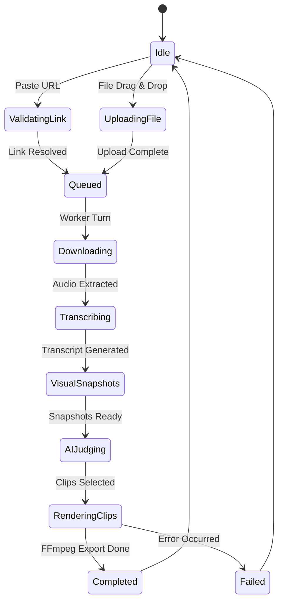

# Cat's Eye - Phase 1 Technical Specification
**Specification:** `PHASE_1_SPEC.md`  
**Phase:** Phase 1 - Complete Brand Identity and UI Redesign  
**Status:** DRAFT - PENDING USER REVIEW & ALIGNMENT  
**Date:** November 2026  
**Author:** Senior Full-Stack Software Engineer & UI/UX Architect  

---

## 1. Overview & Objectives

Phase 1 transforms the existing **PeakCut** application into **Cat's Eye**, a high-precision, AI-powered vertical video production studio. 

### Core Goals:
1. **Brand Identity Overhaul:** Complete transition from PeakCut (warm brown/amber) to Cat's Eye (gemstone-inspired deep charcoal, graphite, emerald green, and luminous accent hues).
2. **Professional UI Redesign:** Modernize the dashboard, navigation, video upload workspace, clip review suite, and modals into a high-tier creative tool interface.
3. **100% Functional Preservation:** Zero regressions in video downloading, chunked uploads, local speech-to-text, snapshot extraction, AI clip analysis, dynamic multishot rendering, subtitle burning, social account OAuth, or job queue management.
4. **Zero Backend Rewrite:** Maintain all internal Python modules, environment variables (`PEAKCUT_*`), database tables, and API endpoints to ensure seamless compatibility with existing deployments and databases.
5. **Future Readiness:** Reserve structured navigation placeholders for future phases (Asset Library, Presets, Viral Intelligence Engine, etc.) without fake mock features.

---

## 2. Exact Files to Add and Change

### 2.1 New Files to Add
| Path | Purpose |
|---|---|
| `web/brand/logo-light.svg` | Primary horizontal Cat's Eye vector logo for expanded sidebar and headers (Gemstone cat's eye icon + "Cat's Eye" typography). |
| `web/brand/logo.svg` | High-contrast dark-mode vector logo for public surfaces and export headers. |
| `web/brand/favicon.svg` | Standalone gemstone pupil icon mark for browser tabs, app icons, and collapsed sidebar. |
| `docs/ARCHITECTURE_AUDIT.md` | Full architecture audit of the existing PeakCut system. |
| `docs/specs/PHASE_1_SPEC.md` | This technical specification. |

### 2.2 Existing Files to Modify
| Path | Scope of Modification |
|---|---|
| `web/index.html` | **Primary Target:** CSS `:root` design token overhaul (emerald & charcoal theme), font imports, inline SVG logo replacement, refreshed navigation with future placeholders, redesigned hero and composer, updated clip card styling, and modal restyling. Replace all user-visible strings ("PeakCut" → "Cat's Eye"). |
| `web/landing.html` | Public landing page brand identity and color palette update to match the Cat's Eye theme. |
| `web/auth.html` | Sign-in and registration pages updated with Cat's Eye branding and emerald accents. |
| `web/admin.html` | Admin portal updated with Cat's Eye brand styling. |
| `web/reset.html` | Password reset interface updated with Cat's Eye brand styling. |
| `web/legal.html` | Terms of service and privacy policy pages updated with "Cat's Eye" brand references. |
| `studio/server.py` | Update HTML title metadata and user-facing notifications/alerts where appropriate while keeping internal routes unchanged. |

---

## 3. Function Signatures & Frontend Architecture

The single-page frontend in `web/index.html` utilizes pure vanilla JavaScript with an optimized micro-rendering pipeline. No function logic will be broken. Below are the key function signatures and how they will be adapted for Phase 1.

### 3.1 Frontend Functions (`web/index.html`)

```javascript
/**
 * Renders the persistent application shell (sidebar, navigation, topbar, status pills).
 * Updates:
 * - Employs Cat's Eye SVG logos (expanded logo-light.svg, collapsed favicon.svg).
 * - Injects structured navigation items: Dashboard, New Project, All Videos, Creators, 
 *   plus "Coming Soon" sections (Asset Library, Presets, Processing History).
 * - Restyles AI status badge and user profile avatar dropdown.
 */
function drawShell(): void;

/**
 * Renders the dashboard overview.
 * Updates:
 * - Welcome greeting banner ("Welcome to Cat's Eye").
 * - High-impact stat KPI tiles (Clips Created, Processing Queue, AI Calls, Storage Health).
 * - Quick-start project composer CTA.
 * - Active video processing pipeline cards and recent clip showcase.
 */
function drawOverview(): void;

/**
 * Renders the video upload and ingestion composer.
 * @param {"hero" | "compact"} variant - Display variant for hero banner or library header.
 * Updates:
 * - Refreshed upload dropzone with emerald hover/active states.
 * - Restyled clip configuration parameters (layout selection: Multishot, Blur, Zoom, Crop; 
 *   caption styles: Bounce, Hype, Clean; duration steppers).
 */
function drawAdd(variant: "hero" | "compact"): void;

/**
 * Renders active job queues and finished video cards.
 * Updates:
 * - Progress indicator bars styled in emerald with pulse animations.
 * - Distinct badges for processing stages (Downloading, Transcribing, Vision Snapshots, AI Judging, Rendering).
 */
function drawJobs(): void;

/**
 * Renders individual clip preview cards within a video container.
 * Updates:
 * - Virality score badges with color-coded emerald/yellow/ruby tiers.
 * - Multishot composition indicator badges.
 * - Hover play controls with subtle color shifts.
 */
function drawClips(job: object): string;

/**
 * Opens and renders the clip detail and trimming dialog (#clipdlg).
 * @param {string} jid - Job identifier.
 * @param {string} cid - Clip identifier.
 * Updates:
 * - Clean dual-pane editor (left: 9:16 video player stage; right: transcript, shot breakdown, caption adjustments, social dispatch).
 */
function drawClipDialog(jid: string, cid: string): void;

/**
 * Interactive spotlight onboarding tour.
 * Updates:
 * - Updated step copy introducing Cat's Eye capabilities.
 * - Restyled spotlight ring and dark charcoal card.
 */
function startTour(): void;
```

---

## 4. Database Tables & Columns

### 4.1 Schema Migration Decision for Phase 1: **None (Zero Changes)**
To preserve 100% backward compatibility with all existing user data, jobs, and settings:
- No SQLite or PostgreSQL tables are modified in Phase 1.
- No columns are renamed or deleted.
- Existing database tables (`users`, `sessions`, `usage`, `email_ok`, `email_tokens`, `feedback`, `notices`, `admin_log`) remain unchanged.

### 4.2 Future Schema Reservations (Phase 2+)
The following future schemas are planned for subsequent phases and will NOT be created in Phase 1:
- `asset_library`: Metadata for sound effects, B-roll overlays, memes, and audio tracks.
- `presets`: Editing style templates (Meme, Podcast, Streamer, Cinematic).
- `viral_metrics`: Platform engagement telemetry and feedback learning.

---

## 5. API Routes & Request/Response Contracts

All existing backend routes in `studio/server.py` are preserved. The Phase 1 UI interacts with the following existing endpoints:

### 5.1 System Status (`GET /api/status`)
Used by `drawShell()` to verify system health, AI status, FFmpeg availability, and current user.
- **Request:** `GET /api/status`
- **Response Example:**
```json
{
  "ready": true,
  "accounts": true,
  "user": {
    "id": "usr_94a7e8b2",
    "name": "Alex Vance",
    "email": "alex@example.com",
    "is_admin": true,
    "role": "admin"
  },
  "ai": {
    "ready": true,
    "provider": "gemini",
    "model": "gemini-2.5-flash",
    "today_calls": 14,
    "today_tokens": 128400
  },
  "no_ffmpeg": false,
  "styles": {
    "bounce": "Bounce (Word highlight)",
    "hype": "Hype (Punchy)",
    "clean": "Clean (Minimal)"
  },
  "layouts": {
    "multishot": "Dynamic Multishot",
    "blur": "Blurred Fill",
    "zoom": "Center Zoom",
    "crop": "Fit Crop"
  },
  "unread": 2
}
```

### 5.2 Dashboard Overview (`GET /api/overview`)
Used by `drawOverview()` to populate dashboard metrics and active jobs.
- **Request:** `GET /api/overview`
- **Response Example:**
```json
{
  "jobs_total": 48,
  "clips_total": 214,
  "clips_today": 12,
  "recording_now": 0,
  "queue_depth": 1,
  "recent_jobs": [
    {
      "id": "job_01h8q7",
      "title": "Lex Fridman Interview Highlights",
      "status": "done",
      "clips_count": 6,
      "created_at": 1731845120
    }
  ]
}
```

### 5.3 Video Ingestion (`POST /api/jobs`)
Triggered from the primary composer in `drawAdd()`.
- **Request:**
```json
{
  "url": "https://www.youtube.com/watch?v=dQw4w9WgXcQ",
  "creator": "c_techreviews",
  "options": {
    "max_clips": 6,
    "min_len": 15,
    "max_len": 60,
    "style": "bounce",
    "layout": "multishot",
    "quality": 720
  }
}
```
- **Response Example:**
```json
{
  "id": "job_7f8a91b2",
  "status": "queued",
  "stage": "Waiting in line",
  "created_at": 1731851400
}
```

---

## 6. UI States & Design Specifications

### 6.1 Cat's Eye Color Palette (`web/index.html`)
The CSS design system will be updated to the following precise color values:

| Variable | Hex Value | Semantic Role |
|---|---|---|
| `--frame` | `#0F1117` | Deep charcoal / near black application background |
| `--frame-2` | `#1A1D23` | Dark graphite card and panel background |
| `--frame-line` | `rgba(255,255,255,0.08)` | Subtle border separator on dark surfaces |
| `--frame-text` | `#E8EAF0` | Primary white/silver text on dark surfaces |
| `--frame-dim` | `#8B8FA8` | Secondary muted silver text |
| `--bg` | `#14171F` | Main content workspace background |
| `--muted` | `#1E222D` | Secondary panel, input, and container fill |
| `--line` | `#262B3A` | Divider and card border lines |
| `--line-2` | `#32384C` | Interactive element borders (buttons, inputs) |
| `--text` | `#E8EAF0` | Body and title text color |
| `--dim` | `#9BA3BC` | Helper text, secondary descriptions |
| `--faint` | `#5C6280` | Placeholders, disabled markers |
| `--brand` | `#10B981` | Emerald green primary accent |
| `--brand-press` | `#059669` | Pressed/active emerald accent |
| `--brand-ink` | `#022C22` | Text rendered on top of emerald buttons |
| `--brand-soft` | `rgba(16,185,129,0.14)` | Emerald tinted backgrounds & pills |
| `--brand-line` | `rgba(16,185,129,0.30)` | Emerald subtle border highlights |
| `--brand-deep` | `#047857` | Deep emerald tone for links and dark accents |
| `--good` | `#34D399` | Luminous yellow-green secondary accent |
| `--bad` | `#F87171` | Crimson error alert |
| `--live` | `#EF4444` | Recording pulse badge |

### 6.2 Typography
- **Primary Body & UI Font:** `Inter`, `-apple-system`, `BlinkMacSystemFont`, `"Segoe UI"`, `sans-serif`.
- **Display Subtitle Fonts (Preserved):** `Archivo Black`, `Anton`, `Poppins`.

### 6.3 State Catalog



1. **Dashboard Empty State:**
   - Visual: Gemstone wireframe emblem with subtle emerald gradient.
   - Headline: *"No projects in your studio yet"*.
   - Copy: *"Paste a video link or drop in a media file above to generate your first vertical clips."*
   - CTA: Focus URL input field.
2. **Video Ingestion & Progress Indicator:**
   - Multi-stage visual stepper: `[1] Ingestion` → `[2] Transcription` → `[3] AI Analysis` → `[4] Multishot Render`.
   - Percentage progress bar with emerald glow (`#10B981`).
3. **Clip Review Card:**
   - Vertical 9:16 ratio card with rounded corners (`10px`).
   - Virality Score Badge:
     - `90-100`: High Virality (Emerald badge `#10B981`, dark ink).
     - `75-89`: Good Potential (Yellow-green badge `#34D399`, dark ink).
     - `<75`: Standard (Muted silver badge).
   - Layout Indicator: Tag indicating Multishot, Blur, Zoom, or Crop.
   - Dynamic hover action overlay: Quick Preview, Edit Clip, Download MP4, Social Queue.
4. **Navigation Sidebar:**
   - **Expanded (240px):**
     - Header: Cat's Eye gemstone logo + stylized wordmark.
     - Section 1: Studio (`Dashboard`, `New Project`, `All Videos`).
     - Section 2: Workspaces (`Creators` list + `New Creator`).
     - Section 3: Coming Soon (`Asset Library` [Soon], `Presets` [Soon], `Processing History` [Soon]).
     - Footer: AI provider status card + Account flyout + Notifications bell.
   - **Collapsed / Mini (76px):**
     - Header: Cat's Eye gem icon mark only.
     - Nav items: Icons with centered tooltips.
     - "Coming Soon" badges hidden to maintain minimal visual footprint.

---

## 7. Edge Cases & Safeguards

1. **Excessive String Lengths:**
   - Streamer usernames, video titles, and transcript snippets are clamped with CSS text-overflow ellipsis and `-webkit-line-clamp: 2`.
2. **Local Storage Keys Preservation:**
   - Keys such as `peakcut_update_seen`, `peakcut_link`, and `mini` must remain functional so user interface state (e.g., collapsed sidebar preference) is not lost during the rebrand.
3. **Windows 260-Character Path Limits:**
   - Render exports must remain in short temporary folders before atomic move, as documented in `AGENTS.md`.
4. **Contrast Accessibility (WCAG AA):**
   - Text colors (`#E8EAF0`, `#9BA3BC`) tested against background (`#0F1117`, `#1A1D23`) to ensure contrast ratio exceeds 4.5:1.
5. **No-FFmpeg & Full-Drive Alert States:**
   - System alert banners in `.vb` are restyled in emerald-tinted amber/red warnings without disrupting tool-detection logic.
6. **Mobile / Narrow Viewport Responsiveness:**
   - At `<900px`, the sidebar slides off-canvas with a backdrop scrim.
   - At `<560px`, the multi-tile KPI grid collapses from 4 columns to 2 columns; composer buttons wrap cleanly.

---

## 8. Test & Verification Plan

### 8.1 Automated Test Suites
Run existing test runner:
```bash
cd <repo-root>
python tests/run.py
```
**Verification Requirement:** All 16 existing test suites must pass with zero failures:
1. `test_abuse.py`: Rate limiting and request size limits.
2. `test_ai.py`: Multi-provider AI parsing and fallback logic.
3. `test_connect.py`: Social account OAuth connection flows.
4. `test_delete.py`: Cascade deletion of jobs and clips.
5. `test_limits.py`: Upload size and job queue quota enforcement.
6. `test_load_queue.py`: FairQueue concurrency under load.
7. `test_local.py`: Local single-user mode operations.
8. `test_multishot_snapshots.py`: Snapshot extraction and multishot rendering filter graphs.
9. `test_permissions.py`: User isolation and session gates.
10. `test_roman.py`: Transliteration pipeline.
11. `test_storage.py`: Storage path relocation and disk quota warnings.
12. `test_stuck.py`: Unresponsive task timeout and queue recovery.
13. `test_tools.py`: Binary dependency checks (FFmpeg/FFprobe).
14. `test_updates.py`: Release polling.
15. `test_upload_parts.py`: Resumable chunked file upload.

### 8.2 Manual Verification Checklist
- [ ] Application launches cleanly via `python -m studio.server` at `http://127.0.0.1:8765`.
- [ ] Brand vector logos render crisply in both expanded (240px) and collapsed (76px) sidebar states.
- [ ] Dashboard displays Cat's Eye welcome greeting, KPI tiles, and project composer.
- [ ] Pasting a video URL (YouTube, Twitch, Kick) initiates the download and processing sequence.
- [ ] Video playback and scrubbing inside `#clipdlg` works without stutter or aspect ratio distortion.
- [ ] Clip downloads (`.mp4`) download with accurate subtitles and layout formatting.
- [ ] Settings sub-tabs (`AI`, `Profile`, `Security`, `Connected Apps`, `Storage`) operate properly.
- [ ] Guided tour launches cleanly, highlights elements accurately, and dismisses without console errors.
- [ ] Responsiveness tested at 1440px, 1024px, 768px, and 375px widths.

---

## 9. Rollout Plan

1. **Step 1 - Brand Vector Asset Generation:**
   - Create vector files `web/brand/logo-light.svg`, `web/brand/logo.svg`, and `web/brand/favicon.svg`.
2. **Step 2 - Design System & CSS Variable Replacement:**
   - Replace color values in `web/index.html` `:root` block with the deep charcoal and emerald palette.
   - Update typography to Inter.
   - Refactor card, input, and modal background surfaces.
3. **Step 3 - User-Facing Identity Text Refactor:**
   - Update user-facing text strings ("PeakCut" → "Cat's Eye") across page titles, toolbars, tour, and dialogs.
4. **Step 4 - Navigation & Dashboard Layout Polish:**
   - Integrate structured navigation items with future section placeholders (`Asset Library [Soon]`, `Presets [Soon]`).
   - Enhance dashboard KPI cards and composer styling.
5. **Step 5 - Ancillary Web Portal Updates:**
   - Update `web/landing.html`, `web/auth.html`, `web/admin.html`, `web/reset.html`, and `web/legal.html`.
6. **Step 6 - Verification & Regression Testing:**
   - Execute `python tests/run.py` to confirm zero backend regressions.
   - Launch server and perform browser end-to-end verification.

---

## 10. List of Assumptions

1. **Internal Naming Stability:** We assume internal Python package names (`studio`), environment variables (`PEAKCUT_AI_KEY`, `PEAKCUT_ACCOUNTS`), database table names, and REST API paths (`/api/*`) must NOT be renamed to prevent breaking existing installations, deployment scripts, or saved configurations.
2. **Zero Build Pipeline:** We assume the frontend must remain a zero-build, single-file vanilla architecture (`web/index.html`) without introducing Node.js, npm packages, or bundlers.
3. **Typography Source:** We assume loading the `Inter` font via Google Fonts CDN is acceptable, matching the existing pattern used for `Geist`, `Archivo Black`, `Anton`, and `Poppins`.
4. **Phase 1 Boundary:** We assume all advanced features (Asset Library, Presets, Viral Intelligence Engine, GPU acceleration) are strictly reserved for Phase 2 and beyond, and should only appear as non-clickable "Coming Soon" badges in navigation.
5. **Single-User & Multi-User Mode:** We assume both the default local mode (`PEAKCUT_ACCOUNTS=0`) and server multi-user mode (`PEAKCUT_ACCOUNTS=1`) must be equally supported and visually consistent.

---

## 11. Questions for the User

Please review and provide guidance on the following design and implementation decisions before code changes begin:

1. **Public Marketing Pages (`landing.html`, `auth.html`, `admin.html`):**
   - Would you like Phase 1 to include redesigning the public landing page (`web/landing.html`), authentication page (`web/auth.html`), and admin portal (`web/admin.html`) to the new Cat's Eye branding right now, or should we focus exclusively on the signed-in application workspace (`web/index.html`) first?
2. **Accent Shade Nuance:**
   - For the primary emerald accent, do you prefer a vivid modern emerald (`#10B981` / `#059669`) with luminous yellow-green highlights (`#34D399`), or a deeper, more muted jewel-tone emerald (`#047857` / `#065F46`)?
3. **Navigation Future Placeholders:**
   - In the sidebar navigation, we have reserved slots for:
     - *Asset Library*
     - *Presets (Meme, Podcast, Stream)*
     - *Processing History*
   - Should these be displayed with a subtle `Coming Soon` badge in the sidebar, or would you prefer them hidden until their respective phases are implemented?
4. **Batch Launcher & User Guide Renaming:**
   - Should `run_peakcut.bat` and `USER_GUIDE.md` be renamed to `run_catseye.bat` and `CATSEYE_USER_GUIDE.md` (with backward-compatible aliases), or kept as-is during Phase 1?
